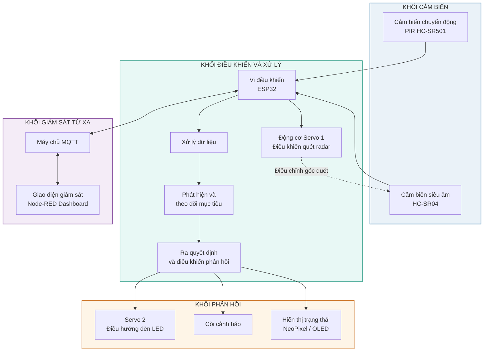
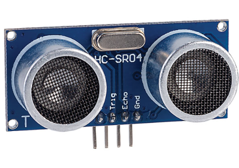
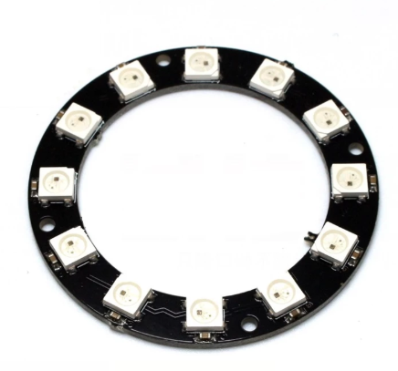
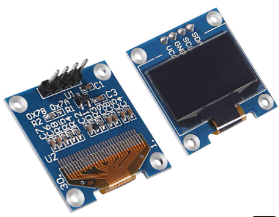
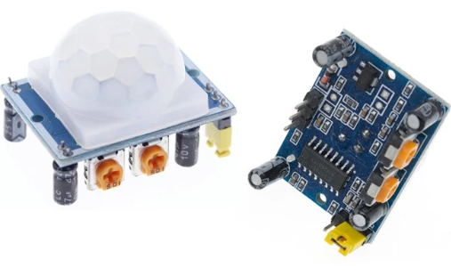
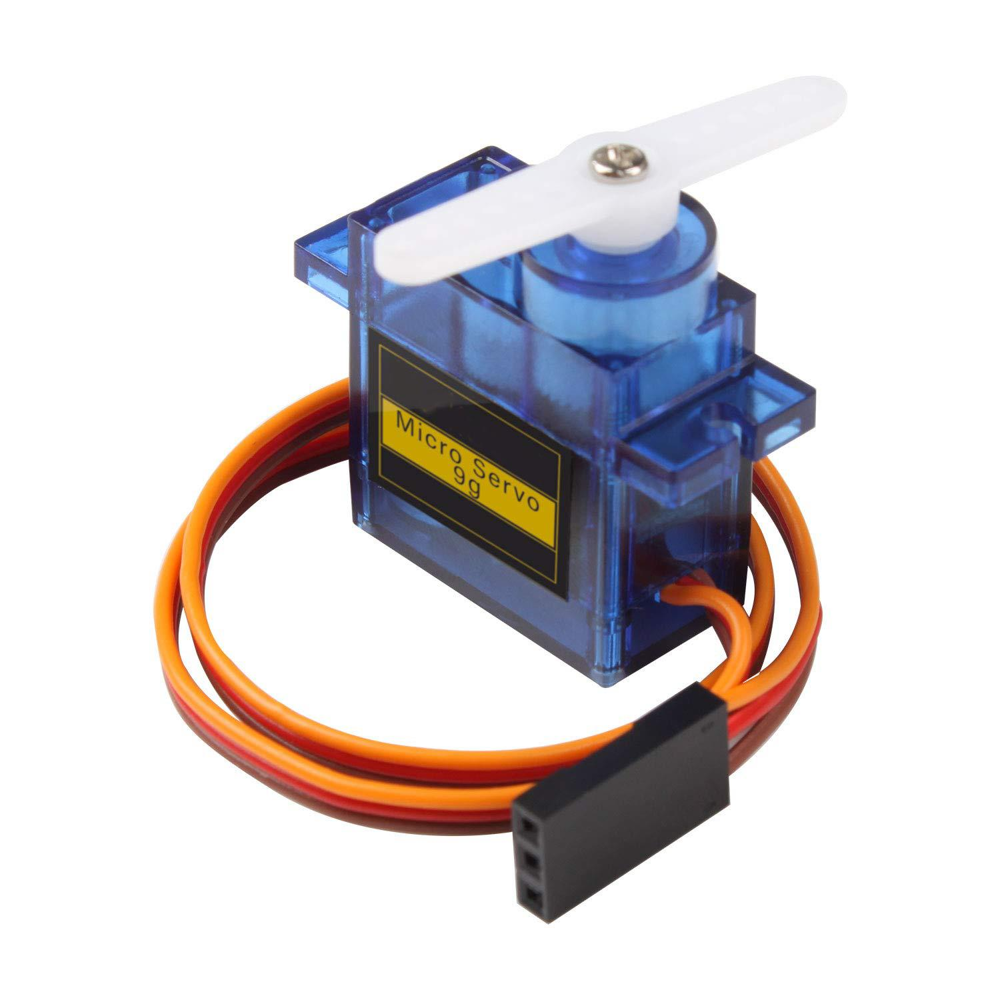

# Smart Radar-Based Target Detection, Tracking and Automated Response System

### Hệ thống radar thông minh phát hiện, theo dõi và phản hồi tự động với mục tiêu

**Sinh viên:** Nguyễn Hoàng Linh  
**Trường:** Trường Đại học Khoa học Tự nhiên – Đại học Quốc gia Hà Nội  
**Ngành:** Kỹ thuật Điện tử - Tin học  
**Học phần:** Phát triển ứng dụng IoT 
**Năm thực hiện:** 2026

---

## 1. Giới thiệu dự án

Dự án hướng đến nghiên cứu và xây dựng một hệ thống giám sát thông minh sử dụng ESP32, cảm biến chuyển động PIR và cảm biến siêu âm HC-SR04 để phát hiện, đo khoảng cách và theo dõi mục tiêu trong một khu vực xác định.

Hệ thống sử dụng động cơ servo để điều khiển cảm biến siêu âm quét theo góc, từ đó thu thập thông tin về khoảng cách tại các vị trí khác nhau. Dựa trên dữ liệu thu được, ESP32 thực hiện xử lý, ước lượng vị trí tương đối và theo dõi mục tiêu qua các lần quét liên tiếp.

Bên cạnh chức năng phát hiện và theo dõi, hệ thống dự kiến tích hợp cơ chế phản hồi tự động thông qua đèn LED, còi cảnh báo và các hiệu ứng hiển thị. Dữ liệu giám sát được truyền qua giao thức MQTT đến giao diện Node-RED Dashboard để quan sát và theo dõi từ xa.

Dự án tập trung vào việc kết hợp kiến thức về hệ thống nhúng, cảm biến, điều khiển cơ cấu chấp hành và truyền thông IoT trong một mô hình thử nghiệm có tính trực quan.

## 2. Đặt vấn đề và phát biểu bài toán

### 2.1. Bối cảnh thực tế

Trong thực tế, việc giám sát chuyển động và phát hiện các đối tượng xuất hiện trong một khu vực nhất định có ý nghĩa trong nhiều lĩnh vực như:

- Giám sát khu vực kho hàng và lưu trữ thiết bị.
- Theo dõi hoạt động trong phòng thí nghiệm và phòng kỹ thuật.
- Phát hiện chuyển động tại các khu vực cần kiểm soát.
- Hỗ trợ giám sát an toàn tại các khu vực hạn chế người ra vào.

Các hệ thống giám sát hiện nay có thể sử dụng camera, cảm biến chuyển động hoặc các thiết bị đo khoảng cách. Tuy nhiên, trong phạm vi một mô hình nhúng quy mô nhỏ, việc kết hợp nhiều cảm biến để phát hiện chuyển động, đo khoảng cách, ước lượng vị trí tương đối và đưa ra phản hồi tự động là một bài toán phù hợp để nghiên cứu và triển khai.

### 2.2. Nhu cầu và vấn đề cần giải quyết

Một hệ thống giám sát cơ bản thường chỉ đưa ra thông báo khi phát hiện chuyển động hoặc có đối tượng xuất hiện. Để tăng khả năng quan sát, hệ thống cần có thêm các chức năng:

- Phát hiện sự xuất hiện của đối tượng trong khu vực giám sát.
- Đo khoảng cách từ cảm biến đến đối tượng.
- Quét khu vực theo nhiều góc khác nhau để thu thập dữ liệu.
- Ước lượng vị trí tương đối của đối tượng dựa trên góc quét và khoảng cách đo được.
- Theo dõi sự thay đổi vị trí của mục tiêu qua các lần quét.
- Phản hồi tự động khi phát hiện mục tiêu theo các điều kiện được thiết lập.
- Truyền dữ liệu đến giao diện giám sát từ xa.

### 2.3. Ý tưởng và nguồn cảm hứng

Ý tưởng ban đầu được hình thành từ các mô hình radar sử dụng cảm biến siêu âm HC-SR04 kết hợp với động cơ servo. Trong những mô hình này, cảm biến được gắn trên servo để quét một vùng không gian theo góc, sau đó hiển thị khoảng cách đo được trên giao diện trực quan.

Từ nguyên lý đó, dự án dự kiến phát triển thêm một số chức năng:

1. Kết hợp cảm biến PIR để hỗ trợ phát hiện chuyển động.
2. Xây dựng cơ chế quét và thu thập dữ liệu khoảng cách theo góc.
3. Xử lý dữ liệu để ước lượng vị trí tương đối của mục tiêu.
4. Theo dõi mục tiêu qua các chu kỳ quét liên tiếp.
5. Điều khiển một cơ cấu servo độc lập để hướng đèn LED về phía mục tiêu.
6. Tích hợp MQTT và Node-RED để giám sát dữ liệu trên giao diện trực quan.

Như vậy, dự án không chỉ dừng lại ở mô hình radar hiển thị khoảng cách mà hướng đến một hệ thống có khả năng phát hiện, theo dõi và phản hồi tự động.

### 2.4. Phát biểu bài toán

Nghiên cứu và xây dựng một hệ thống giám sát sử dụng ESP32 có khả năng phát hiện chuyển động, quét khu vực theo góc, đo khoảng cách và ước lượng vị trí tương đối của mục tiêu trong phạm vi hoạt động của cảm biến.

Hệ thống sử dụng cảm biến PIR để hỗ trợ nhận biết chuyển động và cảm biến siêu âm HC-SR04 gắn trên động cơ servo để thực hiện quá trình quét. ESP32 tiếp nhận và xử lý dữ liệu, từ đó xây dựng cơ chế theo dõi mục tiêu qua các lần quét liên tiếp.

Khi phát hiện mục tiêu thỏa mãn các điều kiện được thiết lập, hệ thống thực hiện phản hồi thông qua cơ cấu servo điều hướng đèn LED, còi cảnh báo và các thiết bị hiển thị. Đồng thời, dữ liệu về góc quét, khoảng cách và trạng thái hoạt động được truyền qua MQTT đến Node-RED Dashboard để giám sát từ xa.

**Bài toán trọng tâm:** Làm thế nào để kết hợp cảm biến, cơ cấu quét, thuật toán xử lý và truyền thông IoT nhằm xây dựng một mô hình nhúng có khả năng phát hiện, ước lượng vị trí, theo dõi và phản hồi với mục tiêu trong một khu vực xác định?

## 3. Mục tiêu dự án

### 3.1. Mục tiêu tổng quát

Xây dựng mô hình hệ thống radar thông minh dựa trên ESP32, kết hợp cảm biến và cơ cấu chấp hành để thực hiện các chức năng phát hiện, đo khoảng cách, ước lượng vị trí, theo dõi mục tiêu và phản hồi tự động.

### 3.2. Mục tiêu cụ thể

- Tìm hiểu nguyên lý hoạt động của cảm biến PIR, HC-SR04 và động cơ servo.
- Xây dựng chương trình điều khiển ESP32 và đọc dữ liệu cảm biến.
- Thiết kế cơ chế quét khu vực theo góc từ 0° đến 180°.
- Xử lý dữ liệu góc và khoảng cách để ước lượng vị trí tương đối.
- Xây dựng thuật toán theo dõi một mục tiêu trong phạm vi thử nghiệm.
- Điều khiển cơ cấu phản hồi bằng servo, đèn LED và còi cảnh báo.
- Tìm hiểu và triển khai truyền thông MQTT.
- Xây dựng giao diện giám sát dữ liệu bằng Node-RED Dashboard.
- Đánh giá hoạt động của hệ thống thông qua các kịch bản thử nghiệm.

## 4. Nội dung và chức năng chính

| STT | Chức năng | Mô tả |
|---|---|---|
| 1 | Phát hiện chuyển động | PIR HC-SR501 hỗ trợ phát hiện chuyển động trong khu vực giám sát. |
| 2 | Quét khu vực | Servo 1 điều khiển cảm biến HC-SR04 quét theo góc. |
| 3 | Đo khoảng cách | HC-SR04 đo khoảng cách từ cảm biến đến vật thể. |
| 4 | Ước lượng vị trí | Kết hợp góc quét và khoảng cách để xác định vị trí tương đối. |
| 5 | Theo dõi mục tiêu | Xử lý dữ liệu qua các lần quét để ước lượng sự thay đổi vị trí của mục tiêu. |
| 6 | Phản hồi tự động | Servo 2 điều hướng đèn LED về phía mục tiêu; còi và LED thực hiện cảnh báo. |
| 7 | Giám sát từ xa | MQTT truyền dữ liệu đến Node-RED Dashboard. |

### 4.1. Nguyên lý ước lượng vị trí

Khi cảm biến siêu âm được đặt tại một góc quét xác định, hệ thống ghi nhận góc \(\theta\) và khoảng cách \(d\).

Trong trường hợp cảm biến được đặt tại tâm hệ tọa độ và mặt phẳng quét được quy ước phù hợp, tọa độ tương đối có thể được ước lượng bằng:

\[
x = d\cos(\theta)
\]

\[
y = d\sin(\theta)
\]

Các giá trị này được sử dụng để biểu diễn vị trí tương đối của đối tượng trên mặt phẳng quét.

### 4.2. Nguyên lý theo dõi mục tiêu

Hệ thống dự kiến sử dụng dữ liệu thu được từ các chu kỳ quét liên tiếp để xác định những điểm đo có khả năng thuộc cùng một mục tiêu.

Việc theo dõi có thể dựa trên các yếu tố như:

- Khoảng cách giữa các vị trí ước lượng ở hai lần quét.
- Mức độ thay đổi khoảng cách đo được.
- Góc quét tương ứng với điểm phát hiện.
- Ngưỡng sai lệch cho phép giữa các lần đo.

Trong phạm vi triển khai ban đầu, hệ thống tập trung theo dõi một mục tiêu trong khu vực thử nghiệm có kiểm soát.

## 5. Sơ đồ khối hệ thống dự kiến

### 5.1. Mô tả các khối chức năng

| Khối | Vai trò |
|---|---|
| PIR HC-SR501 | Phát hiện chuyển động. |
| HC-SR04 | Đo khoảng cách đến đối tượng. |
| Servo 1 | Điều khiển hướng quét của cảm biến siêu âm. |
| ESP32 | Điều khiển hệ thống, thu thập và xử lý dữ liệu. |
| Target Detection & Tracking | Phát hiện và theo dõi mục tiêu dựa trên dữ liệu quét. |
| Servo 2 | Điều khiển hướng của đèn LED phản hồi. |
| LED / NeoPixel / OLED | Hiển thị trạng thái hoạt động. |
| Buzzer | Phát tín hiệu cảnh báo. |
| MQTT Broker | Trung gian truyền nhận dữ liệu. |
| Node-RED Dashboard | Hiển thị thông tin và trạng thái hệ thống từ xa. |

## 6. Phần cứng dự kiến

| STT | Linh kiện | Số lượng | Chức năng |
|---|---|---:|---|
| 1 | ESP32 DevKit V1 | 1 | Vi điều khiển trung tâm, xử lý và kết nối Wi-Fi. |
| 2 | Cảm biến siêu âm Ultrasonic HC-SR04 | 1 | Đo khoảng cách. |
| 3 | Cảm biến thân nhiệt chuyển động PIR HC-SR501 | 1 | Phát hiện chuyển động. |
| 4 | Động cơ Servo SG90 | 2 | Quét cảm biến và điều hướng đèn LED. |
| 5 | Màn hình OLED 0.96 inch SSD1306 | 1 | Hiển thị thông tin cơ bản. |
| 6 | Mạch Hiển Thị NeoPixel Ring 16 RGB LED WS2812| 1-2 | Hiển thị trạng thái bằng màu sắc. |
| 7 | Còi Active Buzzer 5VDC | 1 | Phát âm thanh cảnh báo. |
| 8 | LED Spotlight mini 5V | 1 | Mô phỏng cơ chế phản hồi hướng về mục tiêu. |
| 9 | Nguồn 5V phù hợp | 1 | Cấp nguồn cho các cơ cấu chấp hành. |
| 10 | Breadboard, dây nối, điện trở | Theo nhu cầu | Lắp ráp và kết nối mạch. |

### 6.1. Hình ảnh một số linh kiện

| Cảm biến HC-SR04 | Vòng LED NeoPixel | Màn hình OLED | Cảm biến PIR | Động cơ Servo |
|:---:|:---:|:---:|:---:|:---:|
|  |  |  |  |  |

**Lưu ý thiết kế phần cứng:**

- Chân Echo của HC-SR04 thường xuất tín hiệu 5V, cần sử dụng mạch chia áp trước khi kết nối với GPIO ESP32.
- Servo cần nguồn cấp phù hợp, không nên cấp nguồn trực tiếp từ chân 3.3V của ESP32.
- Khi sử dụng nguồn riêng cho servo, cần nối chung GND giữa nguồn servo và ESP32.
- Cần kiểm tra dòng tiêu thụ và độ ổn định nguồn khi các servo hoạt động đồng thời.

## 7. Công nghệ và công cụ sử dụng

| Công nghệ / Công cụ | Mục đích |
|---|---|
| ESP32 | Nền tảng phần cứng và điều khiển trung tâm. |
| C/C++ | Lập trình hệ thống nhúng. |
| Arduino Framework | Phát triển firmware cho ESP32. |
| Visual Studio Code | Môi trường lập trình và quản lý dự án. |
| PlatformIO | Quản lý thư viện, biên dịch và nạp chương trình. |
| MQTT | Giao thức truyền thông giữa thiết bị và hệ thống giám sát. |
| MQTT Broker | Tiếp nhận và phân phối dữ liệu MQTT. |
| Node-RED | Xây dựng giao diện giám sát và điều khiển. |
| Git & GitHub | Quản lý mã nguồn và tài liệu dự án. |
| Wokwi | Mô phỏng một số thành phần trước khi lắp ráp thực tế. |

## 8. Kế hoạch triển khai

Dự án dự kiến được triển khai theo các giai đoạn sau:

| Giai đoạn | Nội dung thực hiện | Kết quả dự kiến |
|---|---|---|
| 1 | Tìm hiểu linh kiện, nguyên lý hoạt động và thiết kế sơ đồ kết nối. | Hoàn thiện thiết kế phần cứng ban đầu. |
| 2 | Kết nối ESP32 với PIR và HC-SR04. | Đọc được trạng thái chuyển động và khoảng cách. |
| 3 | Tích hợp servo điều khiển cảm biến siêu âm. | Thực hiện quét khu vực theo góc. |
| 4 | Xử lý dữ liệu góc và khoảng cách. | Ước lượng vị trí tương đối của mục tiêu. |
| 5 | Xây dựng thuật toán theo dõi mục tiêu. | Theo dõi được một mục tiêu trong điều kiện thử nghiệm. |
| 6 | Tích hợp servo phản hồi, LED và còi. | Hoàn thiện chức năng phản hồi tự động. |
| 7 | Tích hợp MQTT và Node-RED Dashboard. | Giám sát dữ liệu từ xa. |
| 8 | Kiểm thử, đánh giá và hoàn thiện tài liệu. | Có mô hình thử nghiệm và báo cáo kết quả. |

## 9. Phạm vi và giới hạn dự án

### 9.1. Phạm vi thực hiện

- Xây dựng mô hình thử nghiệm trong khu vực có kích thước xác định.
- Sử dụng cảm biến PIR và cảm biến siêu âm để hỗ trợ phát hiện mục tiêu.
- Quét khu vực trong phạm vi góc hoạt động của servo.
- Ước lượng vị trí tương đối dựa trên góc quét và khoảng cách.
- Theo dõi một mục tiêu trong điều kiện thử nghiệm phù hợp.
- Thực hiện phản hồi bằng đèn LED định hướng và tín hiệu cảnh báo.
- Truyền dữ liệu qua MQTT và hiển thị trên Node-RED.

### 9.2. Giới hạn kỹ thuật

- HC-SR04 đo khoảng cách bằng sóng siêu âm, không cung cấp hình ảnh hoặc khả năng nhận dạng danh tính đối tượng.
- PIR chỉ hỗ trợ phát hiện chuyển động, không cung cấp tọa độ hoặc khoảng cách.
- Một cảm biến HC-SR04 thực hiện quét tuần tự, không đo đồng thời toàn bộ khu vực.
- Kết quả đo có thể bị ảnh hưởng bởi hình dạng, vật liệu, góc phản xạ và môi trường xung quanh.
- Khả năng theo dõi phụ thuộc vào tốc độ quét, độ chính xác cảm biến và thuật toán xử lý.
- Hệ thống là mô hình giám sát và phản hồi an toàn trong môi trường thử nghiệm, không phải hệ thống radar chuyên dụng.

## 10. Kết quả dự kiến

Sau khi hoàn thành, dự án hướng đến các kết quả:

1. Một mô hình phần cứng sử dụng ESP32 và các cảm biến để phát hiện, đo khoảng cách và quét khu vực.
2. Chương trình điều khiển servo và thu thập dữ liệu cảm biến.
3. Thuật toán ước lượng vị trí tương đối và theo dõi mục tiêu trong phạm vi thử nghiệm.
4. Cơ chế phản hồi tự động bằng đèn LED định hướng và còi cảnh báo.
5. Giao diện Node-RED Dashboard hiển thị góc quét, khoảng cách và trạng thái phát hiện.
6. Tài liệu mô tả thiết kế, quá trình triển khai và kết quả kiểm thử.

## 11. Lộ trình phát triển 

Dự án được định hướng phát triển theo hai giai đoạn:

### Giai đoạn 1 – Xây dựng hệ thống giám sát và phản hồi tự động (Mục tiêu trước mắt)

- Xây dựng thuật toán phát hiện và theo dõi mục tiêu dựa trên dữ liệu cảm biến.
- Hoàn thiện cơ chế quét khu vực và ước lượng vị trí tương đối của mục tiêu.
- Tích hợp cơ chế phản hồi tự động bằng còi cảnh báo và đèn LED.
- Kết nối ESP32 với MQTT và xây dựng giao diện giám sát trên Node-RED Dashboard.
- Kiểm thử khả năng phát hiện, theo dõi và phản hồi trong môi trường thử nghiệm.

### Giai đoạn 2 – Mở rộng chức năng giám sát và răn đe (Định hướng tương lai)

- Nghiên cứu khả năng ứng dụng hệ thống trong giám sát và hạn chế động vật xâm nhập các khu vực cần bảo vệ.
- Phát triển cơ chế răn đe không tiếp xúc thông qua âm thanh cảnh báo, ánh sáng định hướng hoặc tín hiệu hình ảnh.
- Nghiên cứu tích hợp thêm cảm biến và camera để cải thiện khả năng nhận biết, phân loại mục tiêu.
- Mở rộng khả năng giám sát từ xa, lưu trữ dữ liệu và quản lý nhiều khu vực thông qua giao diện IoT.

## 12. Tài liệu tham khảo

Các tài liệu dưới đây là nguồn tham khảo ban đầu phục vụ quá trình tìm hiểu và triển khai:

1. [Espressif Systems – ESP32 Documentation](https://docs.espressif.com/projects/esp-idf/en/stable/esp32/)
2. [MQTT – OASIS Standard](https://mqtt.org/)
3. [HC-SR04 Datasheet](https://cdn.sparkfun.com/datasheets/Sensors/Proximity/HCSR04.pdf)

## 13. Trạng thái dự án

<escape>**Project Status:** Proposal / Initial Design</escape>

Dự án hiện đang ở giai đoạn đề xuất ý tưởng, tìm hiểu nguyên lý hoạt động của các linh kiện và xây dựng thiết kế hệ thống ban đầu.

Các nội dung về phần cứng, thuật toán và giao diện giám sát sẽ tiếp tục được cập nhật trong quá trình triển khai.

---

**Author:** Nguyễn Hoàng Linh  
**Repository:** `smart-radar-iot`